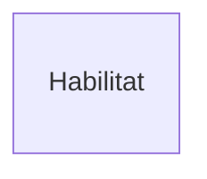

# Model E/R (en Mermaid)
Un diagrama Entidad/Relación E/R es una herramienta fundamental en el diseño de bases de datos. 
Con esta guia, explica paso a paso como hacer todos los elementos del Model E/R, con el diagrama completo al final de la guia. 
## Entitats
Una entidad en un Modelo Entidad-Relación (E/R) es cualquier objeto, concepto o elemento del mundo real sobre el cual queremos guardar información en nuestra base de datos

```mermaid
erDiagram
    Enemic }o--o{  Habilitat : Enfrenta
    Personatge }o--o{ Enemic : Enfrenta
    Personatge }o--o{Habilitat : Poseeix
    Personatge ||--o| Mascota : Acompanya
    Personatge }o--o{ Item : Equipa
    Mascota ||--o{Item : Carrega
    Habilitat }o--o{ Habilitat : Combina

    Enemic {
        String Nom "NOT FULL"
        String Codi PK
        int Tipus "NOT FULL"
        int Nivell "NOT FULL"
        int Vida
        int Força
        int Agilitat
        int Carisma 
    }
    Habilitat {
        String Codi PK
        String Nom "NOT FULL"
        int Cost
        int Dany 
        int Cooldown
        int Tipus "NOT FULL"
    }
    Personatge {
        String DNI PK 
        String Nom "NOT NULL"
        String Cognom
        int Vida
        int Força
        int Agilitat
        int Carisma 
    }
    Item {
        String Nom "NOT FULL"
        String Codi PK
        int Equipable
        int Comerciable "NOT FULL"
        int Tipus "NOT FULL"
        int Pes "NOT FULL"
        int Qualitat "NOT FULL" 
        int X "NOT FULL"
        int Y "NOT FULL"
        int Z "NOT FULL"
        
    }
       Mascota {
        String Num.Chip PK
        String Nom "NOT NULL"
        int Motxilla
    }
    
