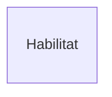
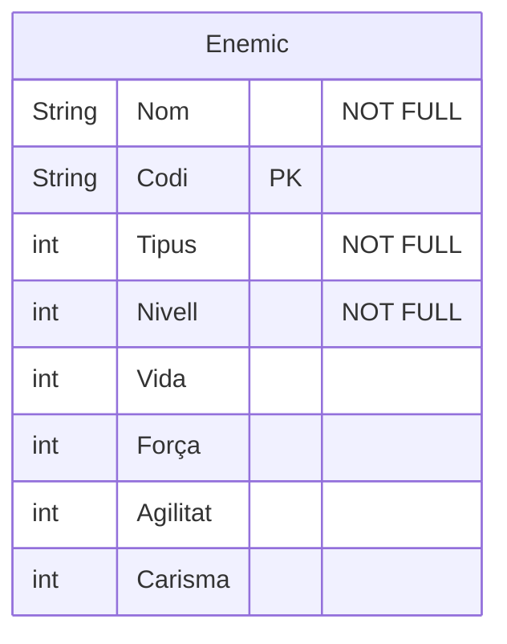
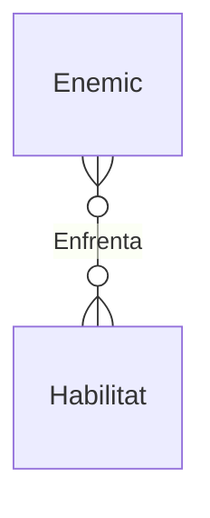
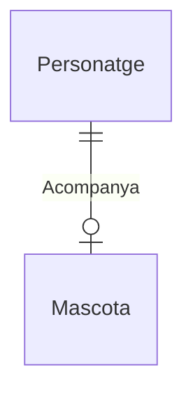
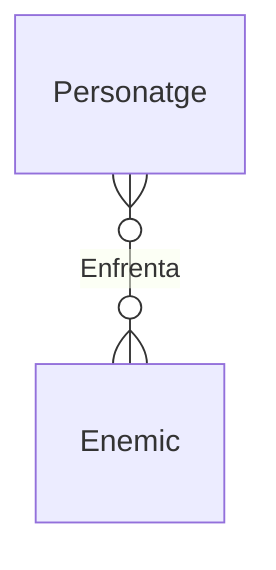

# Model E/R (en Mermaid)
Un diagrama Entidad/Relación E/R es una herramienta fundamental en el diseño de bases de datos. 
Con esta guia, explica paso a paso como hacer todos los elementos del Model E/R, con el diagrama completo al final de la guia. 
## Entidades
Una entidad en un Modelo Entidad-Relación (E/R) es cualquier objeto, concepto o elemento del mundo real sobre el cual queremos guardar información en nuestra base de datos.

  > -  Una de las entidades que he creado para hacer este diagrama a sido la **Habilitat**.

## Atributos 
El atributo es una cualidad, característica o propiedad que define a una persona, objeto, lugar o concepto.
  > -  Dentro de cada una de las entidades hay un atributos que deficenen lo que tiene esa entidad.
>   -  En los atributos he puesto el tipo de atributo que es cada uno de ellos.
>   -  Si esta subralla el aributo he puesto al lado de el un `PK`.
>   -  Y si es obligatorio un `"NOT FULL"`


## Relaciones
Una relación es la unión o conexión entre dos o más elementos. Representa los vínculos o interacciones que hay entre las entidades.
>   -  Representación: Se dibujan como una línea que conecta a las entidades, con un verbo descriptivo en la etiqueta de la línea.

## Cardinalitat de la Relació
La cardinalidad señala cuántas instancias de una entidad pueden asociarse con una instancia de otra. En Mermaid, se representa mediante símbolos situados en los extremos de las líneas.
> - |o : Un o zero

> - || : Exactament un

> - }o : Molts o zero

> - }| : Molts o un

> - o| : Zero o un

## Un a Un (1:1)
Una instancia de la Entidad A se relaciona con, a lo sumo, una instancia de la Entidad B, y viceversa.
> - Exemple: Un PERSONATGE acompaña a una MASCOTA. Una MASCOTA només pot ser acompañada per un PERSONATGE.

## Molts a Molts (M:N)
Cada instancia de la Entidad A puede estar vinculada a varias instancias de la Entidad B, y al contrario.
> - Exemple: Un PERSONATGE pot enfrentar a molts ENEMICS, i un ENEMIC pot enfrenatar a molts PERSONATGES.


# Diagrama final
```mermaid
erDiagram
    Enemic }o--o{  Habilitat : Enfrenta
    Personatge }o--o{ Enemic : Enfrenta
    Personatge }o--o{Habilitat : Poseeix
    Personatge ||--o| Mascota : Acompanya
    Personatge }o--o{ Item : Equipa
    Mascota ||--o{Item : Carrega
    Habilitat }o--o{ Habilitat : Combina

    Enemic {
        String Nom "NOT FULL"
        String Codi PK
        int Tipus "NOT FULL"
        int Nivell "NOT FULL"
        int Vida
        int Força
        int Agilitat
        int Carisma 
    }
    Habilitat {
        String Codi PK
        String Nom "NOT FULL"
        int Cost
        int Dany 
        int Cooldown
        int Tipus "NOT FULL"
    }
    Personatge {
        String DNI PK 
        String Nom "NOT NULL"
        String Cognom
        int Vida
        int Força
        int Agilitat
        int Carisma 
    }
    Item {
        String Nom "NOT FULL"
        String Codi PK
        int Equipable
        int Comerciable "NOT FULL"
        int Tipus "NOT FULL"
        int Pes "NOT FULL"
        int Qualitat "NOT FULL" 
        int X "NOT FULL"
        int Y "NOT FULL"
        int Z "NOT FULL"
        
    }
       Mascota {
        String Num.Chip PK
        String Nom "NOT NULL"
        int Motxilla
    }
    
